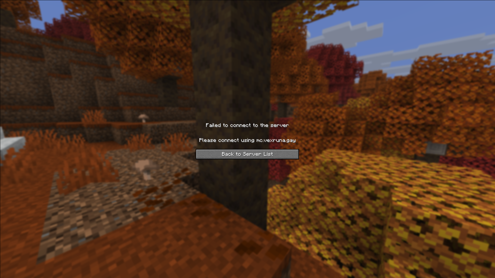

# Description

This is a PaperMC plugin that forces a specific hostname address for people trying to connect to the server.

It only allows connections if the player has explicitly put in the REQUIRED_HOST address and refuses everything else, producing an error message telling them to use the REQUIRED_HOST and creating a log entry in the game server process.

To be able to use it for your own servers you will have to edit the necessary fields yourself.

It was vibe coded from start to finish so use it at your own risk.

# Build instructions

This was made for Minecraft 26.3 and and it requires PaperMC build that supports it.

To build this on your machine you will need to install java, jdk25-openjdk and gradle.

If you happen to have multiple jdk installed you will have to select the correct version.

To build this plugin you can use the `gradle wrapper` command in the root directory and then compile with `./gradlew clean build` to produce the `.jar` file which you can then put into `plugins/` of your minecraft server.

These instructions may be wrong. YMMV.
